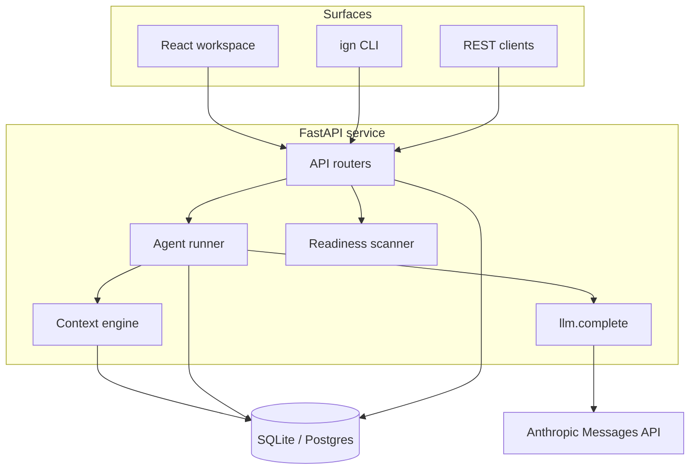

# Architecture

Ignite v0.1 is a single FastAPI service, a React UI and a CLI over one HTTP API.
The full target architecture is in the product spec; this note describes what exists in code.

## Data model (`backend/igniteai/models.py`)

| Table | Purpose |
| --- | --- |
| `workspaces`, `teams`, `projects` | Tenancy and ownership |
| `artifacts` | Typed, versioned graph nodes with status (draft → in_review → approved / rejected) |
| `links` | Typed edges (`implements`, `derives_from`, `visualizes`, …) |
| `memory` | Facts, decisions, standards, procedures with scope, provenance and status |
| `runs` | Every agent execution: input, output, context pack, model, tokens, cost, error |
| `approvals` | Human gates on artifacts |
| `signals` | Questions, unanswered questions and context misses for gap detection |
| `readiness_reports` | Launchpad results per repo |
| `repos` | Onboarded repos: kinds, latest analysis (readiness, API, UI, components, outbound calls), `generated` (generator → reference artifact), scan interval and next scan |
| `mcp_tools` | Gateway registry: one row per tool (enabled, write, status new/active/changed/removed, version, history, pending change, allowed agents, rate limit) |
| `mcp_calls` | Every gateway call: actor, status, latency, bytes before/after projection, redactions |
| `code_graphs` | One per repo: the normalized code graph (symbols, links with relation and confidence), engine version and commit |
| `repo_scans` | Scan history: trigger, grade, commit and the diff against the previous scan (breaking changes, drift, reference refresh) |
| `users`, `memberships` | People from the SSO, and their roles on workspaces (admin, member), teams and projects (viewer, contributor, maintainer, owner); team memberships from SSO groups are marked `sso` |
| `checkpoint_roles` | Who signs off each delivery checkpoint, per project or workspace-wide |
| `api_tokens` | Personal tokens for the CLI and MCP clients (SHA-256 hash only) |
| `audit_events` | Sign-ins, role and visibility changes, sign-offs, releases, denied requests |

## Access control

Sign-in settings come from `igniteai/authconfig.py`: `IGNITE_*` defaults with whatever an admin
saved in the web app on top (refreshed on every request, secrets as `${env:NAME}` references,
with checks that keep at least one admin able to sign in). Feature access is
`igniteai/features.py`: a catalog mapping each feature to its route templates, and a policy per
workspace (everyone / some teams, groups, people / off) that the guard checks after project and
repo access.

`igniteai/auth.py` signs people in three ways, any mix at once: local accounts (scrypt
hashes, lockout after repeated failures, a bootstrap admin / admin that must be changed before
anything else works), LDAP (service-account search with escaped filters, then a bind as the
user; never an empty password) and OIDC (Authorization Code + PKCE; the id_token is checked
against the IdP's keys, issuer, audience, expiry and nonce). It sets a signed HttpOnly session
cookie (ended by a password change) and resolves `Authorization: Bearer ign_...` tokens. `igniteai/api/guard.py` is a
dependency on every router: it finds the workspace, project and repo a path points at
(`access.resolve`) and applies the route's rule (open, signed in, admin, maintainer, viewer for
reads, contributor for writes). Handlers then filter lists and check finer rules: checkpoint
roles (`access.check_sign_off`), the project a new repo goes into, memory scopes. Repo
visibility is `access.can_see_repo`: project access plus, for private repos, GitHub's
collaborator permission for the user's GitHub login, falling back to an explicit project role.
The system map is passed through `repos.system.redact` for repos the viewer can't open.

The principal lives in a context variable (`access.current()`), set by the async guard so sync
handlers and inline agent runs see it; queued runs restore it from `Run.requested_by`
(`user:<id>`). Agent-facing reads (`context.py`, agent tools, code tools, delivery triage) go
through `access.filter_repos` / `filter_memory`. With `auth_mode=none` the principal is a local
admin and nothing is filtered.

## How a run works

1. `POST /api/projects/{id}/runs` creates a `Run` with an agent name, goal, input and autonomy level.
2. The **context engine** gathers target artifacts, their neighbours within two hops, and
   ranked memory visible to the project, within a token budget. The pack is saved on the run.
3. The **agent loop** (`agents/base.py`) sends the goal, context and tool definitions to the
   Messages API. The model replies with tool calls; the platform executes them
   (`agents/tools.py`) and returns results, until the model calls `finish` or a guardrail
   stops it (max turns, token budget). Each tool call runs in a savepoint, so a bad call is
   reported back to the model without corrupting the run.
4. Write tools apply the autonomy level: L0 saves nothing, L1 saves drafts, L2 sends to review
   with an approval, L3+ saves as approved. Agent memory is always *proposed*.
5. The **Orchestrator** has a `delegate` tool that runs specialists as child runs (depth 1),
   inheriting its autonomy. Its plan comes from the model, not from code.
6. Every model turn and tool call is stored in `runs.trace`, with tokens and cost. A failed run
   rolls back its writes but keeps its audit trail.

## Configuration

- **MCP servers** (`mcp_servers`) are scoped to a workspace, team or project; the narrowest scope
  wins on name clashes. A server's tools are discovered on test and cached; agents with
  `uses_mcp = True` see the cached, allow-listed tools as `mcp__<server>__<tool>`. Write tools
  need the server's minimum autonomy (default L2); L0 never executes them. Secrets are
  `${env:NAME}` references resolved in the runner's environment at call time.
- **Runners** decide where a run executes. Resolution: the run's own override, then the agent's
  workspace setting, then the workspace default runner, then `inline`. The resolved config is
  stored on the run (`runs.config`). Non-inline runs are `queued`; `ign runner start <name>`
  claims them atomically (safe with several workers) and runs the agent on that machine.
- **Config as code**: `GET/POST /api/workspaces/{id}/config` exports/applies YAML, upserting by
  name in one transaction.

## Context control and grounding

- Context packs are budgeted per agent (`context_budget`).
- Tool results are capped (`tool_result_max_chars`) and stay valid JSON when truncated.
- Above `compaction_threshold_tokens`, older tool results are replaced with pointers; the most
  recent results stay verbatim. Compactions and peak context size are recorded on the run.
- Agents track `seen_ids` (context pack, tool results, own writes). Citations
  (`artifact:<id>`, `memory:<id>`) and `sources` outside that set are rejected; memory proposals
  must cite their sources.

## Extending

- **New agent:** subclass `Agent`, set `system` (how it should work) and `tools`, implement
  `task` (the opening message), `offline_script` (a deterministic run for tests) and optionally
  `result`; register it in `agents/__init__.py`, add a test.
- **New tool:** add a handler and `Tool` entry in `agents/tools.py`; write tools must go through
  `Agent.save_artifact` / `Agent.remember`.
- **New readiness check:** add it in `repos/checks.py::run_checks` with a weight, a fix, the repo kinds it applies to and, if Ignite can draft it, a `generate` id.
- **New repo kind or framework:** detection lives in `repos/profile.py`; routes in `repos/api_extract.py`; pages in `repos/ui_extract.py`; connections in `repos/deps.py`. Add a fixture repo in `tests/test_repos.py`.

## Repo intelligence (Launchpad)

Onboarding a repo runs one deterministic pass (no model, so it is fast, repeatable and never invents endpoints):

1. **Profile**: the repo is classified into one or more kinds (frontend, backend, api, infrastructure, config, data, library, mobile, docs, monorepo), each with the evidence behind it.
2. **Kind-aware readiness**: common checks run everywhere; code, API, frontend, infrastructure, config and library checks run only where they apply. Non-applicable checks are `skip` and don't affect the score.
3. **API**: checked-in contracts win; otherwise routes are inferred from code and turned into OpenAPI 3.1, marked `x-source: inferred`.
4. **UI**: routes → components → a wireframe of each page's real headings, inputs, buttons and child components.
5. **Components**: a graph of what the repo connects to, every node backed by file:line evidence.

Missing items (agent instructions, overview, architecture, ownership, API contract) are created **in Ignite, not in the repo** (Ignite usually doesn't own these repos): as reference artifacts in the repo's project, with conventions proposed to project memory. Agents use them immediately.

### Across repos and over time

- **System map** (`repos/system.py`): outbound HTTP calls (`repos/consumers.py`) are matched to other repos' endpoints, with the base URL/env var used to disambiguate; config repos link by file name, infrastructure by resource name; shared external services are joined. `GET /workspaces/{ws}/system-map`, `GET /repos/{id}/impact` (dependents, endpoint consumers, calls to endpoints that don't exist).
- **Agents**: `build_context_pack` adds compact repo summaries (the project's own repo, then the best keyword matches); `search_repos` and `get_repo` tools return capped, code-derived facts.
- **Kept current** (`repos/service.py`): an in-process scheduler (`IGNITE_REPO_SCAN_INTERVAL_HOURS`, default 24; per repo via `PATCH /repos/{id}`) and `POST /webhooks/github` rescan repos. Each scan is diffed with the previous (`repos/diff.py`): removed endpoints, new required parameters or fields, removed response fields and new auth are breaking and raise `breaking_change` signals naming consumers. References refresh: drafts update in place; approved references get a pending update a person accepts (`POST /repos/{id}/references/{item}/accept`). Private repos clone with `IGNITE_GIT_TOKEN` / `GITHUB_TOKEN` from the environment.
- **Contracts** (`repos/api_enrich.py`): request/response models (Pydantic, Java DTOs), query params, auth and error codes from code, plus examples that power the mock server (`/repos/{id}/mock/...`). Checked-in contracts are compared with routes in code (drift). `POST /repos/{id}/enrich-api` runs an optional model pass; only endpoints that exist are updated and the tokens are recorded as an `api-enricher` run.

### Code graph

- **Build** (`repos/codeparse.py`, `repos/codeindex.py`): Ignite's own extractor, no external tool and no model. `codeparse` walks tree-sitter syntax trees (Python, JavaScript, TypeScript/TSX, Java, Go) into per-file facts: symbols with exact start/end lines, imports (type-only ones marked), calls with their receiver, references (annotations, `Depends(fn)`, JSX), declared types of parameters, fields and locals, and notes (docstrings, JSDoc, Go doc comments, NOTE/WHY/DECISION comments). Facts are cached per file by content hash in `IGNITE_DATA_DIR/codegraph/<hash>`, so rescans parse only changed files. `codeindex` resolves them across files: per-file scopes from imports (Python packages and relative imports, JS/TS relative and `@/` paths, Java packages and imports, Go modules from `go.mod`), then each call through nested functions, the file's scope, `self`/`this`/the Go receiver plus inheritance, or the receiver's declared type (`repo.save()` with `repo: OrderRepo`) → `extracted`. A callee unique in the repo and not a common word is linked by name only → `inferred` (for a method, only when the receiver's name matches the class). Library calls are never guessed into repo code. Subsystems are Louvain communities (networkx, seeded so they stay stable). The graph is stored in `code_graphs`; `IGNITE_CODE_GRAPH=false` turns it off. The approach follows [Graphify](https://github.com/Graphify-Labs/graphify) (tree-sitter facts, confidence labels, communities); no Graphify code is used.
- **Summary**: named subsystems (communities), hotspots (most-called functions), import cycles (deferred in-function and type-only imports ignored), design notes, and for every endpoint its handler and the services it reaches. Service attribution: a function that uses an alias imported from a known client library (or a module-level client built from one) uses that service; it follows `calls` edges so `place_order → save_order → SQLAlchemy` attributes PostgreSQL to the endpoint. Services are aligned to component view nodes.
- **Confidence everywhere**: code graph links, component view nodes (env var or host guesses are inferred) and system map edges (endpoint-matched calls are extracted, name-only links are inferred and dashed).
- **Queries** (`repos/codequery.py`, `api/code.py`): explain, path (BFS, reports the weakest hop), keyword query, change impact (files or diff hunks → changed symbols by line range → reverse traversal → endpoints → consumers from the system map → risk) and conflicts between change sets. Name resolution is strict: ambiguous → 409 with candidates, unknown → 404 with suggestions.
- **Agents** (`repos/code_tools.py`): `code_query`, `code_explain`, `code_path`, `code_impact` are read tools for agents and on the Omni endpoint; generated AGENTS.md references point agents at them.
- **Memory**: design-note comments become *proposed* project memory (decision or fact), linked to ADR artifacts whose titles match the refs; at most 20 per scan.
- **Data model** (`repos/datamodel.py`): entities and relationships from SQL, SQLAlchemy, Django and Prisma → ER diagram reference.
- **Change impact** uses exact line ranges and the innermost symbol a hunk touches (a change in a method changes that method, not its class).
- **Scheduled scans** compare the remote HEAD (`git ls-remote`) with the last scanned commit and skip unchanged repos.

## Delivery pipeline

`delivery/` (service, checks, github, webhook, omni), `agents/delivery.py`, `agents/delivery_tools.py`, `api/delivery.py`.

- **Work items** are `issue` artifacts. A stage's state is derived from the artifacts linked to the item (PRD/stories/flows, `task`, `pull_request`, `test_plan`, `review`, `release`, `incident`) and their approvals, so the board can't drift from the graph. Outputs of every stage run are linked back to the item.
- **Checkpoints** are `Approval` rows with a `role` taken from the artifact type: issue → product owner, design artifacts → tech lead, review → engineer, release → release manager, incident → on-call. `POST /work-items/{id}/advance` refuses a stage until the previous checkpoint is signed off (design needs approved scope; build needs approved design if there is one; deploy needs an approved review). Releases are gated at every autonomy level. The orchestrator can only delegate to design specialists, so it can't skip a checkpoint.
- **Agents** decide their steps from goals and tools; the checks behind the tools are deterministic (`delivery/checks.py`), so offline runs and tests produce the same results:
  - Triage readiness scoring.
  - Coding handoff brief: start points ranked by word stems against the issue, impact computed from those functions.
  - QA: test plan from the PR's diff, CI classification, and a retry decision capped by `IGNITE_DELIVERY_MAX_RETRIES`.
  - Review findings.
  - Release plan.
  - SRE multi-window burn rates (fast burn 14.4x over 5m and 1h pages; slow burn 6x over 1h and 6h tickets).
- **Coding agents** stay external. The brief is served at `GET /tasks/{id}/handoff`, by `ign delivery handoff`, and to MCP clients through the Omni tools `ignite_list_tasks`, `ignite_get_task` and `ignite_report_pr`. The GitHub webhook links a PR whose branch is `ignite/<task id>-…` or whose description says `Ignite-Task: <id>`, and records check runs on the PR and its test plan.
- **SLOs** are `slo` artifacts with samples (`POST /slos/{id}/samples`, from metrics pipelines or monitoring MCPs). The scheduler checks them every tick. When there's a breach during a rollout whose approved plan allows auto-rollback, the release is rolled back, an incident is opened for on-call, and a follow-up issue (`derives_from` the incident) goes back to triage. Open incidents aren't duplicated.
- **Preview:** `scripts/demo_delivery.py` runs the real backend through the whole journey and records each step. The preview replays those steps in order.

## Next (from the roadmap)

Durable background runs (workflow engine), pgvector semantic memory, Jira and Linear as issue sources, deploy-tool connectors for promote/rollback, SSO and policies.

## MCP gateway

Modelled on a control plane / data plane split:

- **Registry (control plane, `mcp_registry.py`)**: native MCP servers are synced by listing their tools (on add/test, `POST /mcp/{id}/sync`, and by the scheduler every `IGNITE_MCP_SYNC_INTERVAL_HOURS`). Every repo scan turns the repo's API contract into a *generated* server (`api-<repo>`) with one tool per endpoint: path/query parameters and the request model become the input schema, the HTTP method decides `write`. Generated tools and tools that appear on a re-sync start **disabled**; changed descriptions or schemas wait in `pending` until an owner approves (`/mcp-tools/{id}/approve|reject|rollback`). A native server's first sync is enabled because the owner just added it.
- **Invoke (data plane)**: agents, the CLI (`ign mcp call`), the API and the Omni endpoint all go through `invoke()`: enabled check, per-tool agent allow-list, rate limit, autonomy for writes, then the call (MCP for native servers; HTTP to the server's base URL, or the contract's example response when none is set, for generated ones), then projection to requested `fields`, redaction of PII and secrets, size cap and a `mcp_calls` row.
- **Agents**: with few tools each is offered directly (plus an optional `_fields`); above `IGNITE_MCP_DISCOVERY_THRESHOLD` (15) agents get `gateway_discover_servers`, `gateway_list_tools`, `gateway_get_schema` and `gateway_invoke` instead, so context stays small however many tools exist.
- **Omni MCP** (`POST /api/workspaces/{ws}/mcp/omni`): a streamable-HTTP MCP server with the same four discovery tools, for Claude Code and other clients. Writes need `X-Ignite-Autonomy` at or above the server's minimum.
