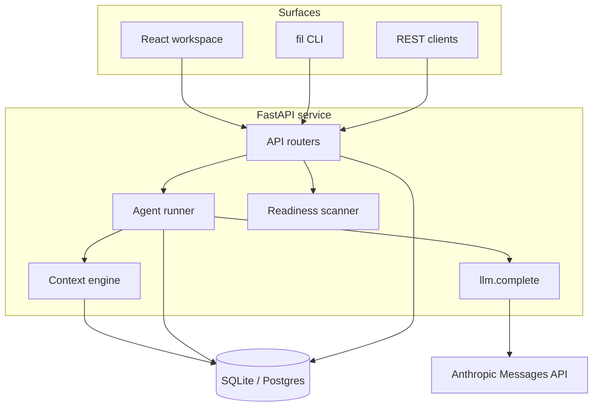

# Architecture

Filament v0.1 is a single FastAPI service, a React UI and a CLI over one HTTP API.
The full target architecture is in the product spec; this note describes what exists in code.

## Data model (`backend/filament/models.py`)

| Table | Purpose |
| --- | --- |
| `workspaces`, `teams`, `projects` | Tenancy and ownership |
| `artifacts` | Typed, versioned graph nodes with status (draft → in_review → approved / rejected) |
| `links` | Typed edges (`implements`, `derives_from`, `visualizes`, …) |
| `memory` | Facts, decisions, standards, procedures with scope, provenance and status |
| `runs` | Every agent execution: input, output, context pack, model, tokens, cost, error |
| `approvals` | Human gates on artifacts |
| `signals` | Questions, unanswered questions and context misses for gap detection |
| `readiness_reports` | Launchpad results per repo |
| `repos` | Onboarded repos: kinds, latest analysis (readiness, API, UI, components) and `generated` (generator → draft artifact) |

## How a run works

1. `POST /api/projects/{id}/runs` creates a `Run` with an agent name, goal, input and autonomy level.
2. The **context engine** gathers target artifacts, their neighbours within two hops, and
   ranked memory visible to the project, within a token budget. The pack is saved on the run.
3. The **agent loop** (`agents/base.py`) sends the goal, context and tool definitions to the
   Messages API. The model replies with tool calls; the platform executes them
   (`agents/tools.py`) and returns results, until the model calls `finish` or a guardrail
   stops it (max turns, token budget). Each tool call runs in a savepoint, so a bad call is
   reported back to the model without corrupting the run.
4. Write tools apply the autonomy level: L0 saves nothing, L1 saves drafts, L2 sends to review
   with an approval, L3+ saves as approved. Agent memory is always *proposed*.
5. The **Orchestrator** has a `delegate` tool that runs specialists as child runs (depth 1),
   inheriting its autonomy. Its plan comes from the model, not from code.
6. Every model turn and tool call is stored in `runs.trace`, with tokens and cost. A failed run
   rolls back its writes but keeps its audit trail.

## Configuration

- **MCP servers** (`mcp_servers`) are scoped to a workspace, team or project; the narrowest scope
  wins on name clashes. A server's tools are discovered on test and cached; agents with
  `uses_mcp = True` see the cached, allow-listed tools as `mcp__<server>__<tool>`. Write tools
  need the server's minimum autonomy (default L2); L0 never executes them. Secrets are
  `${env:NAME}` references resolved in the runner's environment at call time.
- **Runners** decide where a run executes. Resolution: the run's own override, then the agent's
  workspace setting, then the workspace default runner, then `inline`. The resolved config is
  stored on the run (`runs.config`). Non-inline runs are `queued`; `fil runner start <name>`
  claims them atomically (safe with several workers) and runs the agent on that machine.
- **Config as code**: `GET/POST /api/workspaces/{id}/config` exports/applies YAML, upserting by
  name in one transaction.

## Context control and grounding

- Context packs are budgeted per agent (`context_budget`).
- Tool results are capped (`tool_result_max_chars`) and stay valid JSON when truncated.
- Above `compaction_threshold_tokens`, older tool results are replaced with pointers; the most
  recent results stay verbatim. Compactions and peak context size are recorded on the run.
- Agents track `seen_ids` (context pack, tool results, own writes). Citations
  (`artifact:<id>`, `memory:<id>`) and `sources` outside that set are rejected; memory proposals
  must cite their sources.

## Extending

- **New agent:** subclass `Agent`, set `system` (how it should work) and `tools`, implement
  `task` (the opening message), `offline_script` (a deterministic run for tests) and optionally
  `result`; register it in `agents/__init__.py`, add a test.
- **New tool:** add a handler and `Tool` entry in `agents/tools.py`; write tools must go through
  `Agent.save_artifact` / `Agent.remember`.
- **New readiness check:** add it in `repos/checks.py::run_checks` with a weight, a fix, the repo kinds it applies to and, if Filament can draft it, a `generate` id.
- **New repo kind or framework:** detection lives in `repos/profile.py`; routes in `repos/api_extract.py`; pages in `repos/ui_extract.py`; connections in `repos/deps.py`. Add a fixture repo in `tests/test_repos.py`.

## Repo intelligence (Launchpad)

Onboarding a repo runs one deterministic pass (no model, so it is fast, repeatable and never invents endpoints):

1. **Profile**: the repo is classified into one or more kinds (frontend, backend, api, infrastructure, config, data, library, mobile, docs, monorepo), each with the evidence behind it.
2. **Kind-aware readiness**: common checks run everywhere; code, API, frontend, infrastructure, config and library checks run only where they apply. Non-applicable checks are `skip` and don't affect the score.
3. **API**: checked-in contracts win; otherwise routes are inferred from code and turned into OpenAPI 3.1, marked `x-source: inferred`.
4. **UI**: routes → components → a wireframe of each page's real headings, inputs, buttons and child components.
5. **Components**: a graph of what the repo connects to, every node backed by file:line evidence.

Missing items (agent instructions, overview, architecture, ownership, API contract) are created **in Filament first**: as draft artifacts in the repo's project, with conventions proposed to project memory. Agents can use them immediately; `GET /repos/{id}/export` gives the files to commit once a person approves them.

## Next (from the roadmap)

Durable background runs (workflow engine), pgvector semantic memory, code index and context
graph, connectors (GitHub, Jira, Slack) via MCP, test/release/ops agents, SSO and policies.
