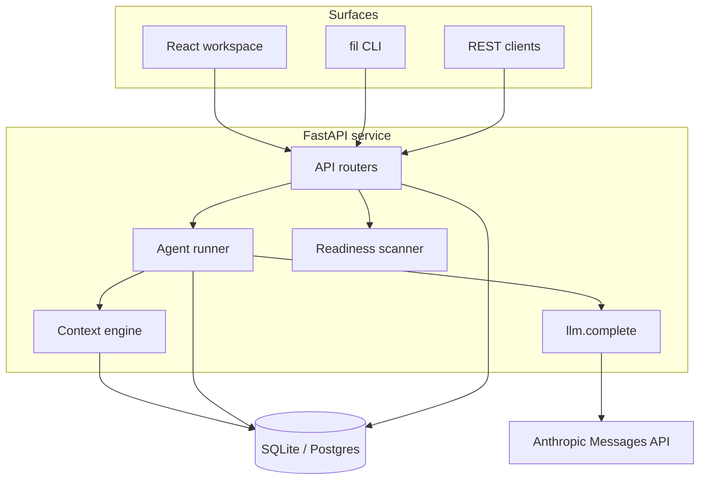

# Architecture

Filament v0.1 is a single FastAPI service, a React UI and a CLI over one HTTP API.
The full target architecture is in the product spec; this note describes what exists in code.

## Data model (`backend/filament/models.py`)

| Table | Purpose |
| --- | --- |
| `workspaces`, `teams`, `projects` | Tenancy and ownership |
| `artifacts` | Typed, versioned graph nodes with status (draft → in_review → approved / rejected) |
| `links` | Typed edges (`implements`, `derives_from`, `visualizes`, …) |
| `memory` | Facts, decisions, standards, procedures with scope, provenance and status |
| `runs` | Every agent execution: input, output, context pack, model, tokens, cost, error |
| `approvals` | Human gates on artifacts |
| `signals` | Questions, unanswered questions and context misses for gap detection |
| `readiness_reports` | Launchpad results per repo |

## How a run works

1. `POST /api/projects/{id}/runs` creates a `Run` with an agent name, goal, input and autonomy level.
2. The **context engine** gathers target artifacts, their neighbours within two hops, and
   ranked memory visible to the project, within a token budget. The pack is saved on the run.
3. The **agent** calls `llm.complete` (Anthropic Messages API, or an offline stub), parses
   JSON, and writes artifacts, links and *proposed* memory according to the autonomy level.
4. Tokens and cost accumulate on the run; failures are recorded, never raised to the client.

## Extending

- **New agent:** subclass `Agent` in `backend/filament/agents/`, implement `execute`, provide an
  `offline_response`, register it in `agents/__init__.py`, add a test.
- **New readiness check:** add it in `readiness/scanner.py::run_checks` with a weight and a fix.

## Next (from the roadmap)

Durable background runs (workflow engine), pgvector semantic memory, code index and context
graph, connectors (GitHub, Jira, Slack) via MCP, test/release/ops agents, SSO and policies.
